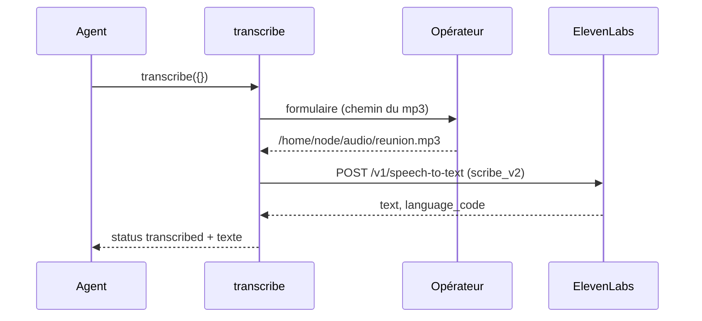

# Architecture

## Structure

```text
src/index.js                  point d'entrée stdio
src/server.js                 création du serveur, enregistrement des outils publics
tools/<outil>/                un dossier par outil ou étape interne
  index.js                    déclaration de l'outil ou de l'étape
  *.test.js ou test/          tests de l'outil
tools/start_workflow/
  index.js                    outil public et routage des étapes (`step`)
  context.js                  chargement des fichiers de contexte
  auto-versioning.js          question à l'opérateur et réponse conservée pour la session
  kawaii.js                   tirage unique de la session pour le style kawaii
  context/                    règles et textes destinés au modèle
  test/fixtures/              dossiers de contexte de test
tools/validate_tests/,
tools/choose_implementation/,
tools/confirm_custom_implementation/
  texts.js                    chargement et rendu des gabarits
  context/                    messages à l'opérateur et à l'agent
tools/keep_track/
  index.js                    outil public et actions sur la mémoire
  memory-store.js             lecture, écriture et effacement de `memory.json`
  memory-rules.js             répétitions, promotion et limites, partagées avec import_memory
  context/                    description de l'outil
tools/operator_form/
  index.js                    ouverture des formulaires, avec le délai de réponse de l'opérateur
tools/neuralyze/
  index.js                    outil public d'effacement de la mémoire
  context/                    description et formulaire de confirmation
tools/devops/
  index.js                    outil public qui renvoie le skill ou une référence
  context/                    consignes d'usage et description de l'outil
  context/skill/              copie du skill externe et de ses références
tools/review/
  index.js                    outils publics review_back et review_front (table SIDES, table MODES)
  context/common/             socle commun des deux revues
  context/back/, context/front/  critères propres à chaque côté
  context/audits/             audits ajoutés par le paramètre `mode`
tools/transcribe/
  index.js                    outil public de transcription d'un mp3 (ElevenLabs Scribe v2)
  context/                    description, formulaire, messages d'échec
tools/handoff/
  index.js                    outil public de passation de la mémoire de keep_track
  context/                    description, gabarit du document et libellés
tools/memory_transfer/
  index.js                    outils publics export_memory et import_memory (paquet JSON versionné)
  context/                    descriptions des deux outils
```

## Du code à l'exposition publique

Le code d'un outil traverse cinq couches, de la plus basse à la plus haute.
Chaque couche ne connaît que celle du dessous.

```text
context/*.md, strings.json      1. textes paramétrables
        │  lus par
texts.js / context.js           2. chargement et rendu
        │  utilisés par
tools/<étape>/index.js          3. logique de l'étape (objet step)
        │  routé par
tools/start_workflow/index.js   4. outil public (registerTool)
        │  enregistré par
src/server.js → src/index.js    5. serveur MCP et transport stdio
```

### 1. Textes paramétrables — `tools/<outil>/context/`

Tout ce qui est destiné au modèle ou à l'opérateur vit dans des fichiers
Markdown ou JSON, jamais dans le code :

- `start_workflow` : les règles (`terminology.md`, `tdd.md`…), les
  instructions du serveur et la description de l'outil, déclarées dans
  `manifest.json` ;
- étapes internes : la description de l'étape (`tool-description.md`), les
  gabarits de messages (`request.md`, `validated.md`…) avec des emplacements
  `{{clé}}`, les libellés du formulaire (`strings.json`) et, pour
  `validate_tests`, le skill de développement (`development-skill.md`).

Modifier un comportement rédactionnel revient à modifier ces fichiers.

### 2. Chargement et rendu — `texts.js` et `context.js`

- `context.js` (`start_workflow`) lit le manifeste, assemble les sections
  demandées dans l'ordre du manifeste (`buildContext`) et fournit les
  instructions et la description (`loadServerTexts`). Le dossier peut être
  remplacé par la variable `POKELEDGER_START_WORKFLOW_CONTEXT_DIR`.
- `texts.js` (une copie par étape) charge les gabarits de l'étape
  (`loadTexts`, d'après sa table `TEMPLATE_FILES`) et remplace les `{{clé}}`
  connues (`renderTemplate`).

Les textes des réponses sont relus à chaque appel : une modification
s'applique sans redémarrer. Les descriptions d'outil et les instructions du
serveur sont lues au démarrage.

### 3. Logique de l'étape — `tools/<étape>/index.js`

Chaque étape interne exporte un objet sans dépendance MCP propre :

```js
export const validateTests = {
  name: "validate_tests",                    // valeur de `step`
  description: loadTexts().toolDescription,  // documentation pour l'agent
  inputSchema: z.object({ /* … */ }),        // contrat d'entrée (zod)
  async run(server, input) { /* … */ },      // logique
};
```

`run` construit le message à partir des gabarits, ouvre le formulaire de
l'opérateur par élicitation MCP (`askOperatorForm`), puis traduit
la réponse en résultat : un texte de consigne pour l'agent (`content`) et un
état exploitable par programme (`structuredContent.status`). Les fonctions
d'aide (`operatorForm`, `reply`, `bullets`) restent privées au module.

### 4. Outil public — `tools/start_workflow/index.js`

`registerStartWorkflow` transforme les étapes internes en outil MCP.
`registerPing`, `registerKeepTrack`, `registerNeuralyze`, `registerHandoff`,
`registerMemoryTransfer`, `registerDevops`, `registerReview` et
`registerTranscribe` déclarent les autres
outils publics, sans étape interne :

1. la table `STEPS` réunit les objets étape par leur `name` ;
2. `registerTool("start_workflow", …)` déclare le schéma public : `sections`,
   `step` (énumération des noms de `STEPS`, dont la description concatène la
   documentation de chaque étape) et `input` ;
3. à l'appel, sans `step`, l'outil renvoie les règles (`buildContext`), avec les
   textes du versionnage automatique (`createAutoVersioning`, un état par
   serveur, textes dans `context/auto-versioning/`, non remplaçables par
   `POKELEDGER_START_WORKFLOW_CONTEXT_DIR`) ; avec
   `step`, `runStep` valide `input` contre l'`inputSchema` de l'étape et
   renvoie une erreur lisible (`isError`) sans solliciter l'opérateur si
   l'entrée est invalide, sinon appelle `run`.

Une étape n'est donc jamais listée comme outil : elle n'est atteignable que
par `start_workflow`.

### 5. Serveur et transport — `src/server.js` et `src/index.js`

- `createServer` crée le `McpServer` avec les instructions issues du contexte
  et enregistre uniquement les outils publics (`registerPing`,
  `registerStartWorkflow`, `registerKeepTrack`, `registerNeuralyze`,
  `registerHandoff`, `registerMemoryTransfer`, `registerDevops`,
  `registerReview`, `registerTranscribe`).
  C'est le point d'entrée des tests, qui s'y connectent par
  `InMemoryTransport`. Ses frontières sont injectables : `random` (aléa),
  `fetch` (réseau, pour l'API ElevenLabs) et `env` (variables
  d'environnement).
- `src/index.js` relie ce serveur au transport stdio ; l'image Docker lance
  ce fichier. Les clients MCP voient alors `ping`, `start_workflow`,
  `keep_track`, `neuralyze`, `handoff`, `export_memory`, `import_memory`,
  `devops`, `review_back`, `review_front` et `transcribe`.

### Flux d'une transcription



### Ajouter une étape interne

1. Créer `tools/<étape>/` avec `context/` (textes) et `texts.js`.
2. Exporter depuis `tools/<étape>/index.js` un objet `{ name, description,
   inputSchema, run }`.
3. L'ajouter à la table `STEPS` de `tools/start_workflow/index.js`.

Aucune modification de `src/` n'est nécessaire. Une nouvelle étape publique
(un outil listé) exigerait au contraire une fonction `register<Outil>` appelée
depuis `createServer`.
